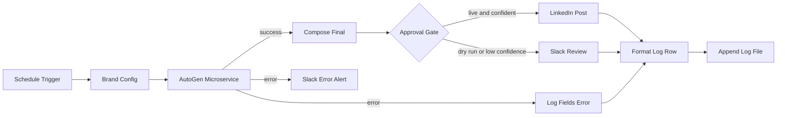

# AI-Powered LinkedIn Content Automation

FinEdge Mumbai course-end project. n8n workflow plus FastAPI AutoGen-style microservice.

**Status:** Microservice and n8n workflow delivered. Ubuntu/WSL smoke tests passed with `MOCK_LLM=true`. Set a real `OPENAI_API_KEY` for live LLM runs; import workflow on the course VM for Slack/LinkedIn UI screenshots.

## 1. Introduction

### 1.1 Purpose
System drafts on-brand LinkedIn posts on a schedule. Humans keep oversight through Slack review. Confident posts publish to LinkedIn when live mode is enabled.

### 1.2 Scope
In scope: `/linkedin` endpoint, n8n workflow, Slack dry run, LinkedIn live path, CSV run log. Out of scope: full AutoGen orchestration, multi-tenant brands, production auth.

### 1.3 Abbreviations
| Term | Meaning |
|------|---------|
| API | Application Programming Interface |
| CTA | Call to action |
| LLM | Large language model |
| VM | Virtual machine |

## 2. Architecture

Fig. 1. Workflow data flow.



### 2.1 Microservice agents
Four sequential OpenAI calls run inside one request. Each agent returns JSON.

TABLE I. Agent roles

| Order | Agent | Output |
|-------|-------|--------|
| 1 | Ideation | `ideas` list |
| 2 | Drafting | `draft` text |
| 3 | Hashtags | `hashtags` list |
| 4 | Critic | `confidence` score, reason |

Guardrail: draft containing a forbidden topic caps confidence at 0.30.

### 2.2 n8n nodes

TABLE II. Workflow nodes

| Node | Type | Role |
|------|------|------|
| Schedule Trigger | Schedule | Weekdays 09:00 IST |
| Brand Config | Set | Brand, context, `dryRun`, `minConfidence`, Slack URL |
| AutoGen Microservice | HTTP Request | POST `/linkedin`; retry twice; error output |
| Compose Final | Set | Join draft and hashtags |
| Approval Gate | IF | Confidence at or above minimum AND `dryRun` false |
| LinkedIn Post | LinkedIn | Live publish (true branch) |
| Slack Review | HTTP Request | Webhook message (false branch) |
| Slack Error Alert | HTTP Request | Failure notice |
| Log Fields (3 nodes) | Set | One row per run: route, status |
| Format Log Row | Convert to File | CSV row |
| Append Log File | Read/Write Files | Append `linkedin_run_log.csv` |

## 3. Repository Layout

```
microservice/
  main.py
  requirements.txt
  .env.example
  sample_request.json
n8n/
  linkedin_content_workflow.json
docs/
  reflection.md
  screenshots/
README.md
```

## 4. Environment Variables

TABLE III. Microservice configuration

| Variable | Default | Purpose |
|----------|---------|---------|
| `OPENAI_API_KEY` | none (required unless mock) | OpenAI credential |
| `OPENAI_MODEL` | `gpt-4o-mini` | Model name |
| `OPENAI_TIMEOUT_SECONDS` | `45` | Per-call timeout |
| `MOCK_LLM` | `false` | Deterministic agents for Ubuntu smoke tests |

Copy `.env.example` to `.env`. Never commit `.env`. For grader demos without billing, set `MOCK_LLM=true`.

## 5. Ubuntu Setup (Canonical)

Prerequisites: Ubuntu VM or WSL2 Ubuntu. Python 3.10+, Node.js 20+.

Automated option:

```bash
chmod +x scripts/setup_ubuntu.sh
./scripts/setup_ubuntu.sh
# edit microservice/.env and set OPENAI_API_KEY
```

Manual steps:

```bash
sudo apt update && sudo apt install -y python3-venv python3-pip curl
curl -fsSL https://deb.nodesource.com/setup_20.x | sudo -E bash -
sudo apt install -y nodejs
sudo npm install -g n8n

cd microservice
python3 -m venv .venv && source .venv/bin/activate
pip install -r requirements.txt
cp .env.example .env && nano .env
nohup uvicorn main:app --host 0.0.0.0 --port 8000 > uvicorn.log 2>&1 &

n8n start
```

Keep the HTTP node URL at `http://127.0.0.1:8000/linkedin`. For remote browser access over plain HTTP, set `N8N_SECURE_COOKIE=false` before `n8n start`.

## 6. Microservice API

### 6.1 Health check
```bash
curl http://127.0.0.1:8000/health
```
```json
{"status": "ok", "model": "gpt-4o-mini", "openai_key_configured": true}
```

### 6.2 Generate post
```bash
cd microservice
curl -X POST http://127.0.0.1:8000/linkedin \
  -H "Content-Type: application/json" \
  -d @sample_request.json
```

Expected response shape (values vary per run):
```json
{
  "ideas": ["Idea one", "Idea two", "Idea three"],
  "draft": "Post text with hook, body, soft CTA.",
  "confidence": 0.82,
  "hashtags": ["#Fintech", "#DigitalPayments", "#FraudPrevention"],
  "meta": {
    "model": "gpt-4o-mini",
    "started_at": "2026-11-22T09:00:00+00:00",
    "finished_at": "2026-11-22T09:00:07+00:00",
    "duration_ms": 7000,
    "agents": ["ideation", "drafting", "hashtags", "critic"],
    "critic_reason": "Strong hook, on brand, no compliance risk.",
    "flags": [],
    "meets_threshold": true
  }
}
```

### 6.3 Error responses

TABLE IV. Error contract

| Status | Code | Cause |
|--------|------|-------|
| 400 | `validation_error` | Missing or invalid body field |
| 500 | `config_error` | `OPENAI_API_KEY` unset |
| 500 | `internal_error` | Unexpected failure |
| 502 | `upstream_llm_error` | OpenAI call failed |
| 502 | `upstream_bad_json` | Model returned unusable JSON |

Body format: `{"error": {"code": "...", "message": "...", "details": [...]}}`.

## 7. n8n Configuration

1. Open n8n. Choose **Workflows**, then **Import from File**. Select `n8n/linkedin_content_workflow.json`. Or paste raw JSON onto the canvas.
2. Open **Brand Config**. Set `slackWebhookUrl`. Adjust brand fields. Keep `dryRun` true until LinkedIn works.
3. Create Slack webhook: Slack app, **Incoming Webhooks**, activate, add to channel, copy URL.
4. Create log header once. File path is relative to the n8n working directory:
   ```
   timestamp,route,status,confidence,min_confidence,dry_run,model,draft
   ```
   Save as `linkedin_run_log.csv`. If n8n blocks file access, set `N8N_RESTRICT_FILE_ACCESS_TO` to the log folder and use an absolute path in **Append Log File**.
5. LinkedIn (live mode only): create LinkedIn developer app. Add products *Share on LinkedIn* and *Sign In with LinkedIn using OpenID Connect*. Set redirect URL `http://localhost:5678/rest/oauth2-credential/callback`. Create n8n LinkedIn OAuth2 credential. Put member ID in **LinkedIn Post** `person`.
6. Set `dryRun` false only after a successful Slack dry run.

## 8. Testing Procedure (Ubuntu)

### 8.1 Microservice
1. `GET /health` returns `ok` (includes `mock_llm` flag).
2. `POST /linkedin` with `sample_request.json` returns all five fields.
3. Send `{}`. Expect HTTP 400.
4. With `MOCK_LLM=false` and blank API key, expect HTTP 500 `config_error`.
5. Optional helper: `microservice/.venv/bin/python scripts/e2e_dry_run_sim.py` writes gate/log artifacts under `docs/screenshots/`.

### 8.2 Individual nodes
Use **Execute Node** in order: Brand Config, AutoGen Microservice, Compose Final, Approval Gate, Slack Review. Inspect output after each.

### 8.3 Full workflow
1. Dry run: `dryRun` true. Expect Slack message and CSV row with route `slack_review`.
2. Low confidence: set `minConfidence` to 0.99. Expect Slack route.
3. Failure: stop uvicorn. Expect Slack alert and row with route `error`.
4. Live: `dryRun` false, `minConfidence` 0.7. Expect LinkedIn post and route `linkedin_live`.

### 8.4 Threshold tuning
Review the CSV after several runs. Raise `minConfidence` if weak drafts reach LinkedIn. Lower it if good drafts always need review.

## 9. Screenshots to Capture

Save in `docs/screenshots/` from the Ubuntu environment.

1. `curl` health and `/linkedin` output.
2. n8n canvas with all nodes.
3. Execute Node output for AutoGen Microservice.
4. Slack message from dry run.
5. CSV log with three route types.

## 10. Debugging Notes

TABLE V. Common failures

| Symptom | Likely cause | Fix |
|---------|--------------|-----|
| HTTP node `ECONNREFUSED` | Service down or wrong host | Start uvicorn. Check URL. |
| HTTP node timeout | Slow model | Raise node timeout and `OPENAI_TIMEOUT_SECONDS`. |
| 400 from service | Body shape wrong | Compare with `sample_request.json`. |
| 502 `upstream_llm_error` | Bad key, quota, network | Check key and billing. Read `uvicorn.log`. |
| Slack node fails | Placeholder webhook | Set real URL. |
| Gate always goes to Slack | `dryRun` true or low score | Check Compose Final output. |
| CSV not written | File access blocked | See Section 7, step 4. |

## 11. Design Decisions and Trade-offs

See `docs/reflection.md`.

## 12. References

[1] FastAPI documentation, https://fastapi.tiangolo.com
[2] n8n documentation, https://docs.n8n.io
[3] OpenAI API reference, https://platform.openai.com/docs/api-reference
[4] Microsoft AutoGen, https://microsoft.github.io/autogen
[5] Slack Incoming Webhooks, https://api.slack.com/messaging/webhooks
